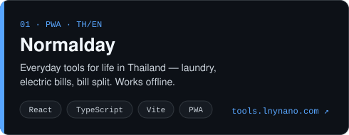
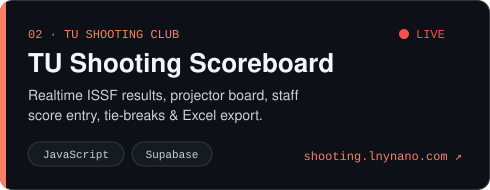

<p align="center">
  <a href="https://lnynano.com">
    
  </a>
</p>

<p align="center">
  <a href="https://lnynano.com"></a>
  <a href="mailto:kiktichej@lnynano.com"></a>
  <a href="https://lnynano.com/cv"></a>
  <a href="https://www.instagram.com/lnynano"></a>
</p>

<p align="center">
  I build practical tools for everyday problems — web apps, data/AI projects, and small utilities I actually use.<br>
  <sub>สร้างเครื่องมือที่ใช้ได้จริงสำหรับปัญหาในชีวิตประจำวัน — เว็บแอป งานข้อมูล/AI และยูทิลิตี้เล็ก ๆ ที่ใช้เองทุกวัน</sub>
</p>

<br>

## ⌁ Featured projects

<p align="center">
  <a href="https://github.com/Lnynano/normalday"></a>
  <a href="https://github.com/Lnynano/tu-shooting-scoreboard"></a>
</p>

<p align="center">
  <a href="https://tools.lnynano.com">Normalday live ↗</a> &nbsp;·&nbsp;
  <a href="https://shooting.lnynano.com">Scoreboard live ↗</a>
</p>

<details>
<summary><b>More projects</b></summary>
<br>

| Project | What it does | Stack |
|---|---|---|
| [**Thong Yip Thong Yod**](https://github.com/Lnynano/Thong-Yip-Thong-Yod) | Multi-agent AI gold-trading dashboard — RSI/MACD/Bollinger, news sentiment, paper trading, backtests *(CN240)* | Python · GPT-4o-mini · Gradio · LightRAG |
| [**TU ECE Room Booking**](https://github.com/Lnynano/Tu_Django_Roombooking_web) | Department room booking with approval workflow, email notifications and usage reports *(CN334, team of 4)* | Django · Docker |

</details>

<br>

## ⌁ Tech I use

<p align="center">
  <br>
  <br>
  
</p>

<br>

## ⌁ Currently

```text
▸ building   Normalday into my everyday toolkit
▸ building   a Windows maintenance tool  (PowerShell → desktop app)
▸ learning   systems, networking & security
▸ studying   B.Eng. Computer Engineering @ Thammasat (Rangsit), 2023 –
```

<br>

<p align="center">
  <picture>
    <source media="(prefers-color-scheme: dark)" srcset="https://raw.githubusercontent.com/Lnynano/Lnynano/output/snake-dark.svg">
    <source media="(prefers-color-scheme: light)" srcset="https://raw.githubusercontent.com/Lnynano/Lnynano/output/snake.svg">
    
  </picture>
</p>
